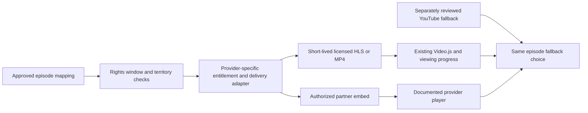

# Licensed playback provider audit

Reviewed: 2026-11-02 (Asia/Manila). Scope: architecture and official-source research before implementing further episode expansion. The project owner confirmed that BryxTV has no content-license agreements or provider partner access yet.

## Decision

Prioritize **licensed, provider-hosted MP4/HLS through the existing Video.js player**, followed by an authorized customizable partner embed. Retain individually reviewed YouTube embeds as fallback. Do not replace one public video-sharing dependency with another and call that a licensed premium catalog.

No newly verified non-YouTube anime/K-drama episode feed was established in this audit. A rights holder's catalog entry, consumer subscription, player account, working media URL or embed toggle does not establish BryxTV's right to distribute a complete season in the Philippines. Private partner feeds might exist; none was made available for testing.

This is an audit and proposed implementation plan, not a new source integration. Existing source records, approvals, application behavior and security settings remain unchanged. No database connections, migrations, writes or production operations were performed.

## Existing architecture

| Area | Existing capability | Gap for licensed primary playback |
| --- | --- | --- |
| `src/features/playback/providers/registry.ts` | Code-controlled exact hostnames, HTTPS validation, MP4/HLS/embed types, player capabilities and CSP origin lists. | MP4 and HLS providers accept only local `/playback/` files. External adapters must be reviewed individually. The shared remote validator rejects every query parameter, including legitimate signed tokens or required embed IDs. |
| `providers/policy.ts` and `providers/resolver.ts` | Exact movie/season/episode identity, provider/source enablement, rights evidence, AVAILABLE status, dated verification and numeric source priority. Failed resolution returns no playable sources. | Numeric priority does not enforce a provider delivery tier. There is no partner asset-ID exchange, per-request URL signing/refresh, contract expiry check or geographic entitlement evaluation. |
| `components/source-selector.tsx` | Chooses among approved sources, preserves user selection per target, and sends MP4/HLS to Video.js or embeds to the iframe player. | Existing saved selections and explicit resume preferences can override default ordering. No automatic failed-source recovery; any future fallback must preserve the exact episode and communicate the source change. |
| `components/video-player.tsx` | Existing Video.js React player, MP4 and native/hls.js playback, captions, fullscreen and user-scoped progress events. | The application passes URLs and basic options only; no configured DRM license service, token refresh or provider-specific authentication. Database-resolved video objects do not currently populate subtitle/audio-track metadata. |
| `components/embedded-player.tsx` | Exact approved iframe URL, limited sandbox permissions, fullscreen and retry UX. | A cross-origin iframe cannot be restyled freely. Progress/seek integration requires the provider's documented SDK/events and a separately reviewed message/origin boundary. Current embeds deliberately have no progress adapter. |
| `src/app/api/playback-sources/route.ts` | Canonical identifiers only, private/no-store responses and no private rights evidence in responses. Public browsing remains available. | Endpoint is public for the currently approved public sources. Restricted licensed content would need appropriate session/entitlement, rights-window and territory checks before minting a playback URL. Better Auth alone does not supply content entitlements. |
| `prisma/schema.prisma` | Provider/source records, priority, exact episode mapping, authorization evidence, availability and review timestamp; separate user-owned watchlist/history. | No structured contract reference, territory grant, rights window, delivery asset ID or playback protection requirements. Free-text evidence is not automatic enforcement of those terms. No migration is proposed until an actual agreement and delivery specification require it. |
| `providers/official-policy.ts` and administration CLI | Strong manual YouTube review, channel identity, format/episode mapping, uniqueness and guarded development-only approvals. | Official review schema is YouTube-specific: video ID, channel and PUBLIC access. It cannot be reused unchanged as a Vimeo, Dailymotion or licensed-feed schema. Duplicate episodes are prohibited inside this manifest, while the database intentionally permits alternative providers for one episode. Keep those concepts separate. |
| CSP and URL checks | Exact origins and no broad arbitrary iframe/media access. | A real HLS contract can require separately reviewed origins for manifests, segments, subtitles, keys and DRM licenses, plus CORS support. Adding a hostname alone is insufficient. |

Safe local policy probes confirmed that the existing MP4/HLS demos and reviewed YouTube URL are accepted, while a synthetic signed external HLS URL is rejected. These probes performed no remote playback or database operations.

The local manifest still describes three previously approved YouTube episodes (One-Punch Man S3E1/S3E2 and Attack on Titan S1E1), one provider-only compilation, and two UNKNOWN candidates. Those are **prior review states**, not fresh November playback or live database verification. Valkaama remains a disabled development example; it is not an expansion target. TMDB supplies discovery metadata, not streaming rights or media delivery.

## Content acquisition shortlist

These are contactable business routes, not publicly available episode APIs. Costs, Philippines rights, exclusivity, full-season availability and technical delivery must be confirmed by the provider.

| Priority / source | Content availability evidence | Realistic delivery route | Limitations and licensing requirements |
| --- | --- | --- | --- |
| 1 — Muse Communication | Official licensing business and a dedicated film/TV inquiry form offering OTT and Internet categories. Existing One-Punch Man/Attack on Titan channel reviews provide discovery leads only. | Request a complete-season or consecutive-episode package for the Philippines with provider-hosted HLS/MP4 or an authorized partner embed. | No public reusable premium feed was identified. Confirm which seasons, subtitles, platforms and streaming models are actually licensable. A public YouTube upload does not grant Video.js redistribution rights. Delivery method and fees are not publicly confirmed. [Muse licensing inquiry](https://www.e-muse.com/en/media-contact/), [company description](https://www.e-muse.com/en/about-us/). |
| 1 — Medialink | Public content-distribution business and corporate partnership contact. Its official 2024 report documents historical distribution titles including Jujutsu Kaisen S2 and Solo Leveling. | Ask the media-content sales team for a current Philippines OTT availability list and full-season delivery specification. | Historical distribution and current **brand/merchandise** licensing pages are not evidence of current Philippines streaming rights. The content directory is dynamic; no current title package, external player grant or direct URL was verified. [Content distribution](https://www.medialink.com.hk/en/Content.aspx), [official historical report](https://www1.hkexnews.hk/listedco/listconews/sehk/2024/0627/2024062702128.pdf), [contact](https://www.medialink.com.hk/en/Contact.aspx). |
| 1 — CJ ENM / TV show sales | Official licensing pages for Queen of Tears and Lovely Runner; each has a 16-episode catalog listing and a GET LICENSE route. | Ask for a Philippines web-OTT package covering the whole series, delivery/security requirements and English subtitles. | A licensing inquiry is not an available Philippines grant; existing exclusivities may prevent a deal. No public partner player or HLS feed was verified. [Queen of Tears](https://www.cjenm.com/en/featured-contents/queen-of-tears/), [Lovely Runner](https://www.cjenm.com/en/featured-contents/lovely-runner/), [official Lovely Runner listing with episode count](https://ocn.tving.com/en/featured-contents/lovely-runner/), [content-sales inquiry instructions](https://www.cjenm.com/en/faq/). |
| 2 — KBS Media | KBS's official purchase page routes overseas use to KBS Media Global. KBS WORLD lists Sirius episodes 1–4 on its own VOD page. | Ask overseas content sales about Sirius or another complete older series with English subtitles and approved off-platform playback. | The four public VOD links are YouTube fallback leads, not a separate customizable feed. Footage sales and personal-use purchases must not be mistaken for a full-series OTT grant. Existing Sirius remains UNKNOWN. [KBS purchase categories](https://about.kbs.co.kr/index.html?sname=kbs&stype=purchase), [overseas contacts](https://global.kbsmedia.co.kr/contact/contacts.php), [Sirius VOD list](https://kbsworld.kbs.co.kr/program/view.php?pg_seq=916). |
| 2 — MBC Global Media | Official drama catalog and business contact page explicitly covering program sales and OTT/channel business. | Request a current Philippines full-series package with delivery and subtitle rights. | No specific available Philippines title package, public embed API or licensed media feed verified. Commercial negotiation and delivery review required. [Drama catalog](https://content.mbc.co.kr/english/drama/index.html), [business contact](https://content.mbc.co.kr/korean/contact/1667946_56517.html). |

Muse's pages were available in official search-index results, but direct retrieval returned 403; that limits inspection confidence. KBS Global and some distributor directories returned minimal/dynamic content. No access controls were bypassed and no contact form or email was submitted. No quote, minimum guarantee or pricing estimate is invented here.

## Delivery/player options are a separate decision

| Option | Fit for BryxTV | Actual content availability | Important constraints |
| --- | --- | --- | --- |
| Rights holder's own HLS/MP4 delivery | Best first target: reuse Video.js, custom Midnight Blue controls and existing progress tracking. Provider hosts the media, meeting the preference not to operate video hosting. | Only the episodes explicitly granted and supplied by the rights holder. **None newly available to BryxTV yet.** | Contract must permit a custom player; verify CORS, expiry, captions, territory, entitlement, device/security requirements and all resource origins. A public URL is not a content license. |
| Rights holder's authorized Vimeo embed | Good conditional route for a partner already hosting licensed episodes there; documented embed customization and domain restrictions exist. | Vimeo is a hosting/player platform; no verified popular anime/K-drama package was established in this audit. | Rights-holder authorization and account capabilities determine branding, domains, ads and access. Use supported APIs/SDK; do not extract streams. [Embedding documentation](https://help.vimeo.com/hc/en-us/articles/12426259908881-How-to-embed-my-video), [embed SDK](https://developer.vimeo.com/player/sdk/embed). |
| Vimeo owner-supplied direct links | Potential Video.js route only when the owner deliberately supplies supported third-party playback links and the agreement permits it. | No licensed episodes supplied. | Official documentation says third-party links bypass Vimeo embed privacy settings and do not expire. They may be unsuitable where the licensor requires expiring access or domain protection. Relevant account plans are required; do not repurpose browser-extracted redirects. [Direct links and limitations](https://help.vimeo.com/hc/en-us/articles/12426150952593-How-to-access-my-video-s-direct-links). |
| Authorized Dailymotion partner player | Supported custom player configuration and documented iframe/script APIs. | No verified rights-holder consecutive anime/K-drama package found during this audit. | Current docs state Studio embedding/custom configuration requires Edge. The current player endpoint requires a valid Player ID and video parameter; legacy parameters are not a reliable customization strategy. Confirm commercial/embed rights, region and ad policy. It remains a provider-controlled player, not a Video.js HLS source. [Studio embedding](https://faq.dailymotion.com/hc/en-us/articles/115008959787-Embed-your-content), [endpoint migration](https://developers.dailymotion.com/v0/reference/migration-guide-new-embed-endpoint). |
| Mux | Strong HLS delivery/security option if a licensor supplies Mux assets or permits ingest and processing. Mux documents HLS playback in third-party players and signed playback. | Infrastructure, not a licensed anime/K-drama catalog. No content grant supplied by opening an account. | If BryxTV ingests licensed files into its own Mux account, it is operating outsourced media hosting, which requires a separate scope/cost decision. Prefer licensor-owned assets initially. Signed tokens and DRM need specific integration; neither is currently wired into BryxTV. [Playback](https://www.mux.com/docs/guides/play-your-videos), [signed access](https://www.mux.com/docs/guides/secure-video-playback), [DRM](https://www.mux.com/docs/guides/protect-videos-with-drm). |
| Consumer services such as Viki, Viu or Crunchyroll | Official external viewing destinations; assess a separate written B2B agreement if one is offered. | Consumer catalog presence does not make episodes usable inside BryxTV. | Their ordinary consumer terms restrict use to personal/noncommercial viewing. No generally reusable licensed BryxTV playback interface was established in this audit. Do not frame consumer pages or extract protected streams. [Viki terms](https://www.viki.com/legal/terms_of_use), [Viu terms](https://www.hq.viu.com/legal/), [Crunchyroll terms](https://www.crunchyroll.com/es-es/tos/). |
| Existing YouTube embeds | Retain as explicit fallback after exact title/episode, publisher, regional and playback checks. | Existing approvals remain unchanged; their ongoing availability was not rechecked. | Respect branding, ads, membership and territory restrictions. No new YouTube-first expansion performed. |

A customizable player is not necessarily fully white-label. Cross-origin iframe internals remain under the provider's control; supported customization is the limit. Brightcove/Kaltura or similar hosting/player products would have the same content-rights prerequisite, so adding another infrastructure vendor alone would not solve the acquisition problem.

## Proposed implementation after a provider is secured

1. **Acquire a contiguous pilot.** Request one complete anime season and one complete K-drama, or a clearly specified consecutive range starting at episode 1. Obtain an exact episode manifest with original titles, release dates, cuts/runtime, provider IDs, TMDB mapping, subtitles/audio, completeness and any embargo. Do not reuse a compilation as independently playable episodes.
2. **Choose the provider's supported delivery.** Prefer its hosted adaptive HLS in Video.js, then hosted MP4 if appropriate, then an approved customizable embed. Obtain a permitted staging asset and technical specification before changing the registry. Do not add guessed domains or fake commercial episode records.
3. **Evaluate the grant per playback request.** Enforce title/episode scope, Philippines territory, rights dates and any required user entitlement. Session checks only apply where the contract requires authenticated access; public browsing and existing free/demo playback remain available. Store stable partner asset references and private contract references, not expiring credentials as permanent source URLs. Return only scoped short-lived playback material with no-store responses.
4. **Extend policy narrowly.** Give the selected provider an exact host/path and query-parameter schema. Permit required signing fields only for that provider; do not remove the existing shared ban for every source. Separately approve manifest/segment/subtitle/license origins and the minimum CSP/iframe permissions required by documented behavior.
5. **Keep the current player.** Feed supported provider media into existing Video.js and preserve canonical per-user/episode progress. Today's Video.js documentation describes structured DRM source configuration, but the installed version and actual browser/engine path must be verified before relying on it. A license URL plus authorization is required; a token is not DRM and using legitimate DRM is not a bypass. [Video.js source/engine/DRM guide](https://videojs.org/docs/framework/html/guides/media-sources).
6. **Order approved sources intentionally.** Default to licensed direct media, then licensed partner embeds, then reviewed YouTube. Distinguish default ranking from explicit saved user preference. Fallback must reference the same cut/season/episode, be visible to the user, and not silently skip an unavailable episode. No such ranking change is applied in this audit.
7. **Adapt administration only to real requirements.** Preserve source IDs and history. Add provider-neutral review/rights fields or a development-only migration only if the agreed format requires them. Keep UNKNOWN/disabled until rights and actual playback are verified. Existing manifest-level duplicate checks must not accidentally prohibit a properly reviewed alternative provider stored in the database.
8. **Test the entire consecutive range.** Verify grant/expiry/territory failures, stale/expired tokens, exact URL and message origins, actual playback/seek/fullscreen, English captions, next/previous and season boundaries, guests/entitled users, mobile/Safari behavior, and watchlist/history isolation. For embeds, implement progress only via reliable documented SDK events. Retain history if a source is withdrawn.

### Information to obtain from sales before implementation

Prepare a brief identifying BryxTV as a Philippines-focused web OTT product. Specify desired anime/K-drama titles and whole-season ranges; expected launch, audience size and viewing model (free, advertising-funded or subscription); web/mobile/TV device scope; English subtitles/audio rights; territory and term; and whether provider-hosted HLS with a custom Video.js player is permitted. Ask for available nonexclusive packages, minimum fees or guarantees, revenue share, DRM/geo/security rules, hosting responsibility, test credentials, reporting and takedown obligations. These are questions for a provider, not assumptions about the terms it will offer. No outreach was sent.

Recommended first outreach routes: Muse's OTT/Internet film-licensing form and Medialink's content-distribution team for anime; CJ ENM's TV-show licensing portal or KBS/MBC overseas OTT sales for drama. Ask about the rights that are available, rather than starting by selecting a streaming vendor. Do not purchase a player subscription in anticipation of rights that have not been granted.

## Preservation and validation

- `tests/ui/history.test.tsx` was already modified before this audit. Reviewed and preserved: `usePlayerProgress` is imported before test registration, preventing an intervening top-level await from allowing DOM teardown before a later test on Node 22.12. No assertions or app progress behavior removed.
- Runtime: Node 22.12.0 from `/usr/local/bin/node`; no machine-wide runtime change.
- `npm test`: 61 core and 17 UI tests passed, including both history UI cases; six opt-in live integration tests skipped.
- ESLint: passed.
- TypeScript (`next typegen && tsc --noEmit`): passed.
- Prisma schema validation: passed with both database URL variables empty; no connection or migration.
- Production build: passed with database/auth/TMDB variables empty, avoiding live dependencies.
- `git diff --check`: passed.
- No new provider, title or episode approvals, no availability changes, no player/API/schema modifications, no production operations, and no commits or pushes.

Only new audit documentation is added by this task. The existing history test fix remains uncommitted and intact. No non-YouTube playback success is claimed: the research establishes realistic acquisition/delivery routes, not a feed that BryxTV is currently licensed to use.
